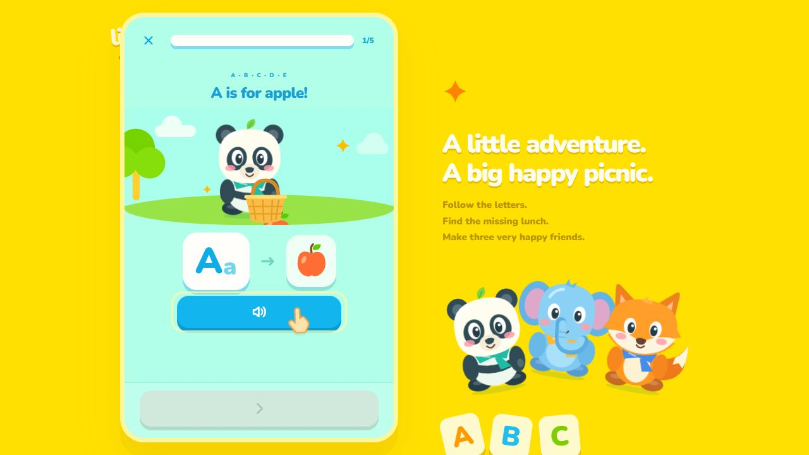
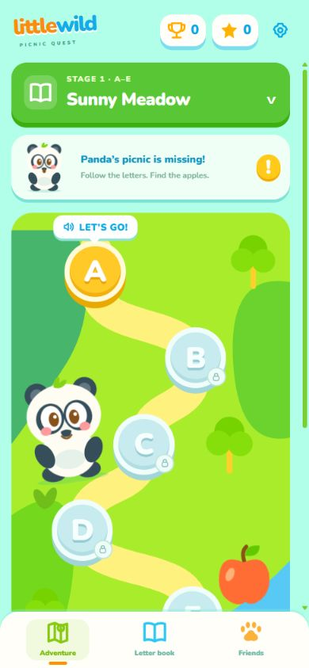
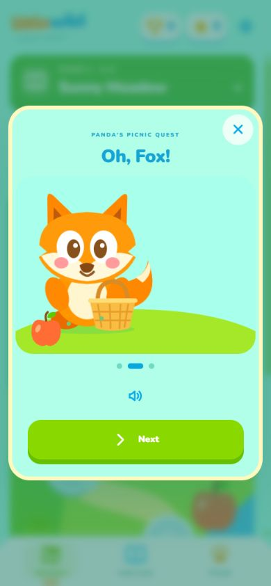
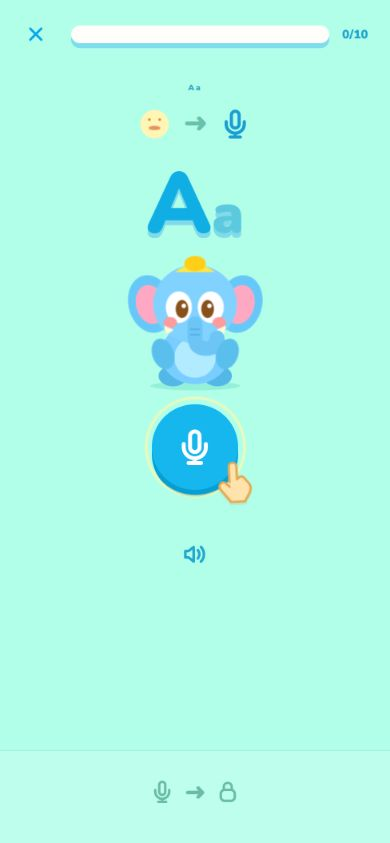

# Little Wild

Little Wild is a free, open-source alphabet adventure for young children. It is designed as a calm alternative to paid, ad-heavy early-learning apps: no ads, no accounts, no in-app purchases, and no paywall.

Panda’s picnic has gone missing. Panda and Elephant follow Fox through six visual stages, learning A–Z along the way. Children are guided by animated pictures, pointers, buttons, and character actions instead of written or spoken instructions.



## What is here today

- Six paced stages: A–E, F–J, K–O, P–T, U–Y, then Z with a short mixed review.
- A separate Letter Book containing every letter without bypassing the adventure.
- Teaching clips such as “A is for apple”; these are examples, not app instructions.
- Listening games and a tap-to-record letter-name check. No transcript is shown.
- Mistakes return after two other questions, so the child gets another gentle try.
- A visual-only Panda / Elephant / Fox story with no narrator, character dialogue, or spoken instructions.
- Three rotating success sounds and one consistent, softer retry sound.
- Local progress only. The app does not save voice recordings or speech transcripts.

The speech check identifies the expected **letter name**. It is not a detailed phonetic pronunciation assessment. Android uses the available system recognizer and may use an on-device model when one is installed; otherwise the provider can require a network connection. The microphone starts only after the child taps it and Android grants permission.

## Screens

| Adventure map                              | Visual story                                  | Speaking check                                             |
| ------------------------------------------ | --------------------------------------------- | ---------------------------------------------------------- |
|  |  |  |

## Try it locally

Requirements: Node.js 22+ for the browser preview; JDK 17 and Android SDK Platform 36 for Android builds.

```sh
npm ci
npm run dev
```

Open `http://127.0.0.1:4174`. Browser speech support varies; use an Android device to assess the real microphone flow.

```sh
npm test
npm run lint
npm run format:check
```

For Android, open [`android`](android) in Android Studio, install Platform 36, allow the project to sync with JDK 17 / Android Gradle Plugin 8.9.1, then use the Gradle panel to run `assembleDebug` or `bundleRelease`. If you use a locally installed Gradle 8.11.1 instead, run:

```sh
gradle assembleDebug
gradle bundleRelease
```

Release signing is deliberately not included. Create and protect your own upload key before making a Play Console release.

## Project shape

```text
web/                 # lessons, learning flow, speech wrapper and editable SVG art
android/             # native WebView, microphone permission and Android speech host
tests/               # learning, retry, audio and privacy behaviour checks
docs/                # screenshots, privacy notes and Play release checklist
```

The animal cast is data, not scattered special cases: [`web/content.js`](web/content.js) defines each animal’s role, every letter’s object/action, and the six stage rewards. This makes it straightforward to add a new animal or revise a lesson without rewriting the game engine.

## Performance notes

| Operation                                      | Cost                                                        |
| ---------------------------------------------- | ----------------------------------------------------------- |
| Convert a recognised letter name to its letter | expected O(1) map lookup after normalising the short result |
| Ask whether a letter/stage is complete         | expected O(1) set lookup                                    |
| Add a missed question after two others         | O(1) linked-queue insertion                                 |
| Build a stage, render its cards, save progress | O(n), because each item must be visited                     |

The fixed alphabet is only 26 letters, but the same structure remains predictable if more activities are added.

## Privacy and child safety

Read [`docs/PRIVACY.md`](docs/PRIVACY.md) before publishing. It records what the app itself stores and the limits of relying on a device speech provider. A production release still needs a public privacy-policy URL, verified Data safety answers, target-audience configuration, and real-device child-flow testing.

## Contributing

Please read [`CONTRIBUTING.md`](CONTRIBUTING.md), [`SECURITY.md`](SECURITY.md), and [`THIRD_PARTY.md`](THIRD_PARTY.md). Do not add tracking, advertising, accounts, an external analytics SDK, or new child data collection without a documented privacy and Play Families review.

## Contributors

- [jessieliao87](https://github.com/jessieliao87)

## License

The Little Wild source code and original visual assets are licensed under [GPL-3.0-only](LICENSE). Distributing a modified version means providing the corresponding source under GPLv3. The bundled Nunito font remains under its own SIL Open Font License. The temporary synthetic teaching audio needs provenance review or replacement before any public-store release; see [`THIRD_PARTY.md`](THIRD_PARTY.md).

## Play Store status

This repository is **not yet a Play Store release**. It targets API 36 and includes a release checklist, but it still needs a verified audio licence, public privacy-policy hosting, a signed AAB, listing material, Play Console declarations, and physical Android-device testing. See [`docs/PLAY_STORE_RELEASE.md`](docs/PLAY_STORE_RELEASE.md).
